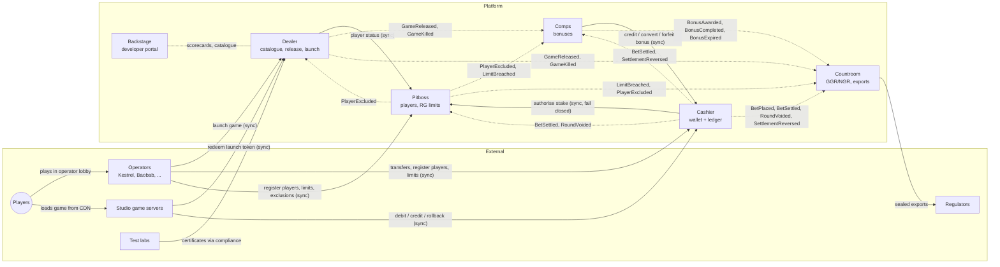

# Architecture

## Style and why
**Microservices, one per business area, owned by one team each; events through a transactional
outbox in PostgreSQL; synchronous calls only where an answer is needed before money moves.**
See `decisions/0001-suite-architecture.md` for the advisor output, the compare table and the rejected options.

Analogy: this is the advisor's "online gambling" reference system (microservices, append-only wallet
ledger, idempotent everything) combined with "banking/payments" (closest by traits: ledger first) and
"clinic" (full audit history). Inside each service the advisor recommends Clean Architecture at launch
(see each `services/<name>/.agentic/decisions/0001-*.md`).

## Context map

Solid arrows are synchronous HTTPS (mTLS). Dotted arrows are events read from the producer's outbox feed.

## Services, owners and what each owns
| Service | Team (topology type) | Owns (source of truth) | Database | Tier |
|---|---|---|---|---|
| `cashier` | team-cashier (stream-aligned) | balances, rounds, wallet transactions, double-entry ledger, reconciliation | `cashier` (dedicated server) | 0 |
| `pitboss` | team-pitboss (complicated subsystem) | players, KYC status, limits, exclusions, rule sets, stake decisions, audit chain | `pitboss` | 0 |
| `dealer` | team-dealer (stream-aligned) | studios, games, builds, certifications, rollouts, kill switches, launch sessions, game health | `dealer` | 1 |
| `comps` | team-comps (stream-aligned) | campaigns, awards, wagering progress, free spins | `comps` | 1 |
| `countroom` | team-countroom (stream-aligned) | bet facts, GGR/NGR, regulator exports, retention | `countroom` | 2 |
| `backstage` | team-backstage (platform) | service catalogue, templates, scorecards, prompt registry, change records | `backstage` | 3 |

Rule: **no service reads another service's database.** Data crosses a boundary only through an API
call or an event (ADR-0002). Contracts live in `contracts/` and each service's `api/openapi.yaml`.

## Sync vs async: the rule
- **Synchronous** when the caller cannot continue without the answer and the answer must be current:
  stake authorisation (Cashier → Pitboss), launch eligibility (Dealer → Pitboss), launch-token redeem
  (game server → Dealer), wallet calls (game server → Cashier), bonus money moves (Comps → Cashier).
  Every sync call has a timeout, a retry policy that is safe because the call is idempotent, and a
  stated failure behaviour (Cashier → Pitboss fails **closed**: no answer, no stake).
- **Asynchronous (events)** for everything that reports a fact others react to: settlement, voids,
  exclusions, releases, bonus state. Consumers are idempotent (inbox on `eventId`).
- **Never** a synchronous chain longer than two hops on the bet path (game server → Cashier → Pitboss).

| Integration | Style | Timeout / budget | If the callee is down |
|---|---|---|---|
| game server → Cashier debit/credit/rollback | sync | Cashier p99 150 ms | game server retries the same transaction id; credits/rollbacks retried until accepted (runbook) |
| Cashier → Pitboss authorise stake | sync | 150 ms, 1 retry inside budget | stake rejected `RG_UNAVAILABLE` (fail closed); wins and rollbacks unaffected |
| operator → Dealer launch | sync | 300 ms | operator shows "game unavailable" |
| Dealer → Pitboss player status | sync | 100 ms | launch refused (fail closed) |
| game server → Dealer redeem | sync | 200 ms | game cannot start; no money at risk |
| Comps → Cashier bonus credit | sync, idempotent on awardId | 500 ms | award stays `pending_credit`, retried by a job |
| all events | outbox feed, polled every 250–1000 ms | consumer lag SLO per consumer | events wait in the outbox (14-day replay window) |

## Cross-cutting
- **Identity**: mTLS everywhere (service mesh issues workload identities). Operators, studios and services each get client certificates; the tenant comes from the certificate, never from a header the caller can set. Staff use OIDC with roles (compliance, release, oncall).
- **Tenancy**: `operator_code` on every row; Pitboss uses PostgreSQL row-level security with `app.operator_code` set per request; Cashier carries the operator inside composite foreign keys so money can't cross tenants.
- **Money**: ADR-0005.
- **Tracing**: OpenTelemetry from the game-server call through Cashier, Pitboss and the database; `traceparent` is copied into every outbox event so a consumer's work joins the original trace.
- **Logging**: structured JSON, no personal data (player id only, never names or DOB); audit is a database record, not a log line.
- **Config**: per-environment config in the repo; secrets in the platform vault, short-lived database credentials, no static secrets in CI (OIDC federation).
- **Errors**: RFC 9457 problem details with a stable `code`.
- **Time**: all timestamps `timestamptz` in UTC; `business_date` is the jurisdiction's trading day, computed once at settlement and carried in `BetSettled`.
