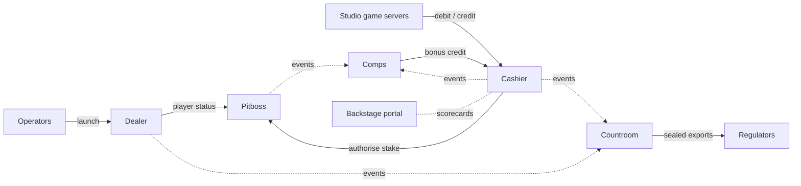

# Casino Platform

A B2B casino-platform suite, designed as one monorepo: a seamless wallet and ledger, responsible
gambling, game release and launch, bonuses, regulatory reporting and a developer portal, supplied to
casino **operators** and the **game studios** that publish onto it. A portfolio piece for system
architecture, platform engineering, cross-team boundaries, regulated-market compliance, PostgreSQL
design and AI-assisted engineering governance.

All operators (Kestrel Gaming, Baobab Casino, Marula Bet, Fynbos Play), studios (Ember Forge,
Tidewater Studio, Quillon Games), people and jurisdictions (A, B, C) are invented. No real data, no secrets.

## Design at a glance
**Brief.** Operators can't offer many studios' games across several regulated jurisdictions without every
integration re-building wallet, responsible-gambling, release and reporting rules. This suite is the
shared, auditable layer between them.

**Architecture.** Six microservices, one per business area and one team each, each with its own
PostgreSQL 16 database. Synchronous calls only where an answer is needed before money moves (a stake is
accepted only after Pitboss approves it, failing closed); every other fact travels as an event through a
transactional outbox that consumers poll (no broker yet). The architecture advisor recommends
microservices for the suite's traits at scale (and a modular monolith for the same traits with one small
team: the evolution trigger is recorded). Money is integer minor units in a double-entry, append-only
ledger, idempotent on the game server's transaction id, and PostgreSQL itself rejects an unbalanced posting.
Full reasoning: [`docs/DESIGN.md`](docs/DESIGN.md).



| Service | Team | Does | Advisor (launch → global) |
|---|---|---|---|
| [`cashier`](services/cashier) | team-cashier | seamless wallet, rounds, double-entry ledger, reconciliation | Clean Architecture → Microservices |
| [`pitboss`](services/pitboss) | team-pitboss | players, KYC status, limits, exclusions, jurisdiction rules, audit chain | Clean Architecture → Microservices |
| [`dealer`](services/dealer) | team-dealer | builds, certification, rollouts, kill switch, signed launch | Layered (overridden to Clean) → Microservices |
| [`comps`](services/comps) | team-comps | bonuses, wagering, expiry; bonus balance separate from cash | Clean Architecture → Microservices |
| [`countroom`](services/countroom) | team-countroom | bet facts, GGR/NGR, regulator exports, retention | Clean Architecture → Microservices |
| [`backstage`](services/backstage) | team-backstage | golden paths, catalogue, scorecards, AI governance | Layered monolith → Modular monolith |


## Run it in GitHub Codespaces

[](https://codespaces.new/Legion91919/casino-platform?quickstart=1)

The dev container installs the SDKs, restores packages and runs every test once on first start. The same setup works locally with VS Code's Dev Containers extension.

| What | Command | Port |
|---|---|---|
| PostgreSQL 16 (dev container service `db`) | `psql -h db -U postgres   # password: postgres` | 5432 |
| All tests (same as CI) | `scripts/test-all.sh` | - |

## What is verified
```bash
tools/db-verify.sh                  # real PostgreSQL 16: 6 databases, 58 tables, 175 assertions (all pass)
python3 tools/validate-contracts.py # 11 event schemas + envelope, valid/invalid examples, 6 OpenAPI 3.1 files, ownership
```

## Map
| Path | What |
|---|---|
| `.agentic/` | suite baton: product brief, context map, ADRs 0001–0005, backlog, quality, runbook |
| `services/<name>/` | README, `.agentic/` (product, ADR-0001, backlog slice 1), `api/openapi.yaml`, `db/migrations/`, `db/tests/` |
| `contracts/` | event JSON Schemas, examples, publisher/consumer table, versioning rules |
| `docs/DESIGN.md` | suite design dossier (14 sections, flows, capacity, STRIDE, drills, Q&A) |
| `docs/team-topology.md` | six teams, interaction modes, cognitive load and autonomy |
| `docker-compose.yml` | PostgreSQL 16 for Cashier (dedicated) and the other five databases (shared server) |
| `tools/` | `db-verify.sh`, `validate-contracts.py`, SQL test helpers, privacy guard |

Built with the Baton model from the Agentic Engineering Kit: frame → map → decide → sketch → slice loop
→ pass the baton. AI agents read `AGENTS.md` first.
