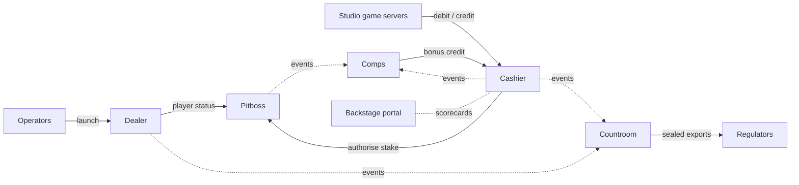
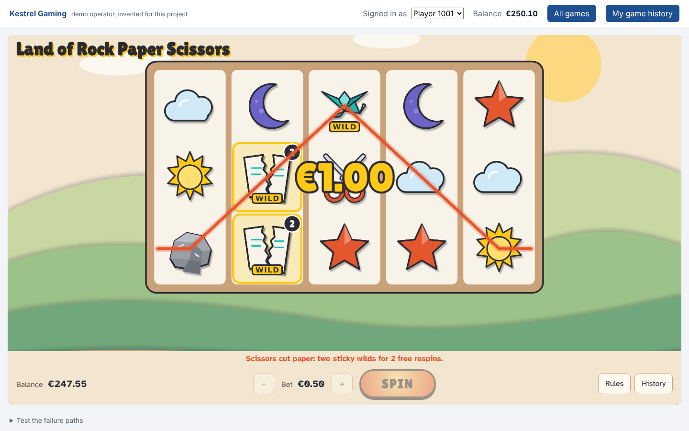
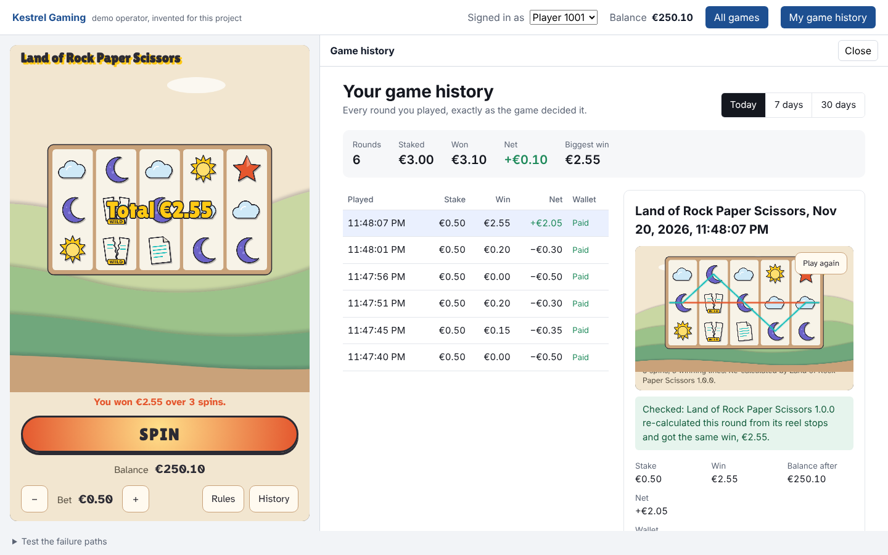
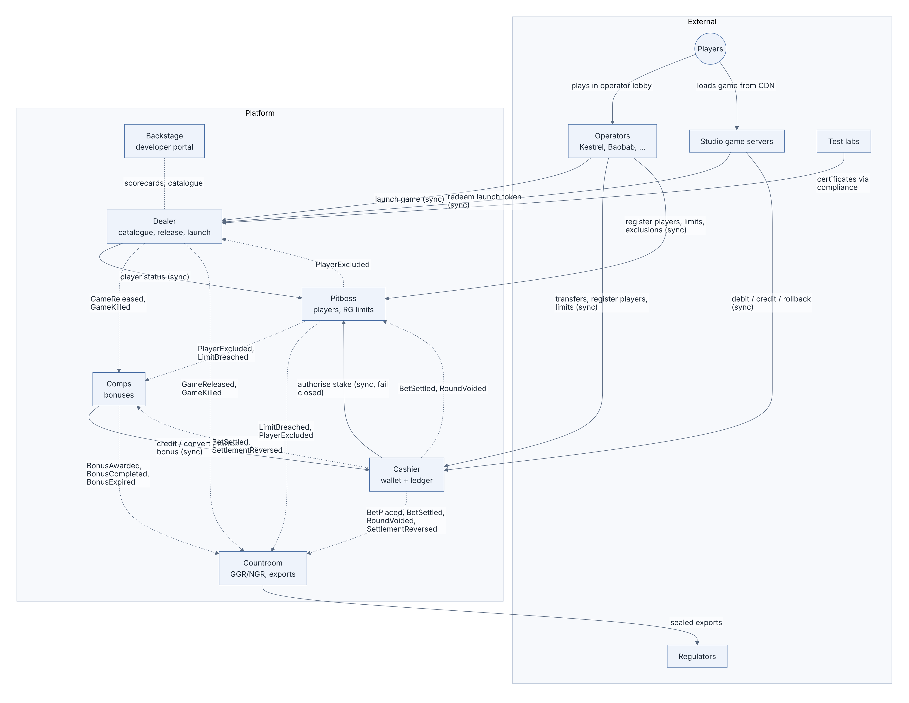
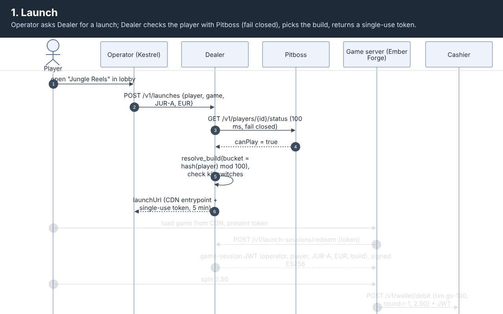
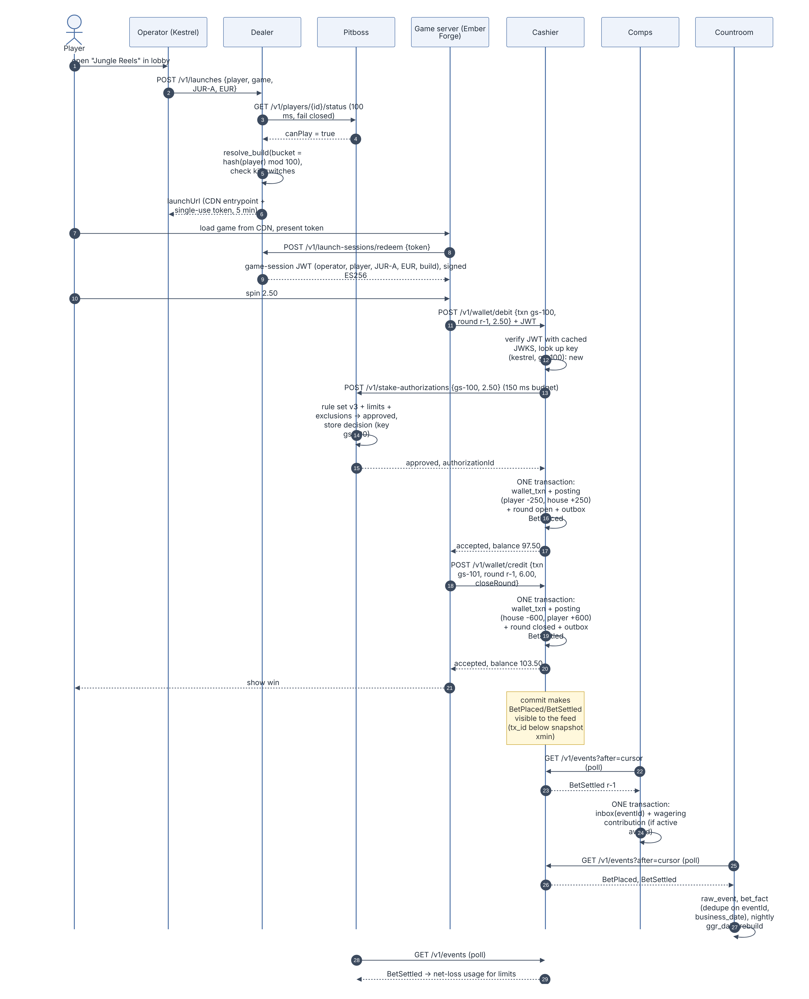
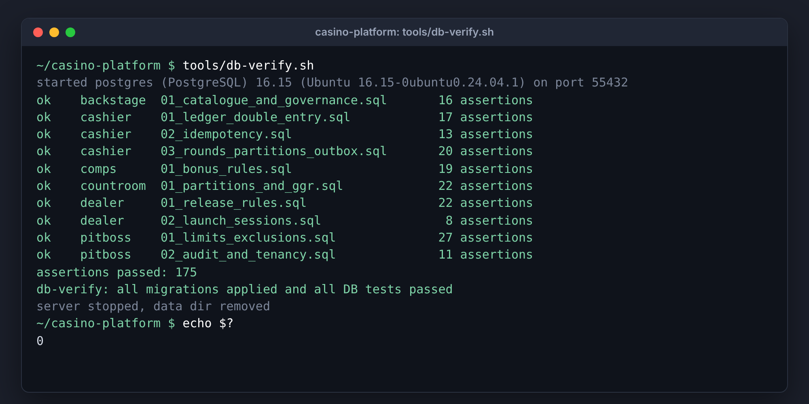

# Casino Platform

A B2B casino-platform suite, designed as one monorepo: a seamless wallet and ledger, responsible
gambling, game release and launch, bonuses, regulatory reporting and a developer portal, supplied to
casino **operators** and the **game studios** that publish onto it. A portfolio piece for system
architecture, platform engineering, cross-team boundaries, regulated-market compliance, PostgreSQL
design and AI-assisted engineering governance.

All operators (Kestrel Gaming, Baobab Casino, Marula Bet, Fynbos Play), studios (Ember Forge,
Tidewater Studio, Quillon Games), people and jurisdictions (A, B, C) are invented. No real data, no secrets.

## Design at a glance
**Brief.** Operators can't offer many studios' games across several regulated jurisdictions without every
integration re-building wallet, responsible-gambling, release and reporting rules. This suite is the
shared, auditable layer between them.

**Architecture.** Six microservices, one per business area and one team each, each with its own
PostgreSQL 16 database. Synchronous calls only where an answer is needed before money moves (a stake is
accepted only after Pitboss approves it, failing closed); every other fact travels as an event through a
transactional outbox that consumers poll (no broker yet). The architecture advisor recommends
microservices for the suite's traits at scale (and a modular monolith for the same traits with one small
team: the evolution trigger is recorded). Money is integer minor units in a double-entry, append-only
ledger, idempotent on the game server's transaction id, and PostgreSQL itself rejects an unbalanced posting.
Full reasoning: [`docs/DESIGN.md`](docs/DESIGN.md).



| Service | Team | Does | Advisor (launch → global) |
|---|---|---|---|
| [`cashier`](services/cashier) | team-cashier | seamless wallet, rounds, double-entry ledger, reconciliation | Clean Architecture → Microservices |
| [`pitboss`](services/pitboss) | team-pitboss | players, KYC status, limits, exclusions, jurisdiction rules, audit chain | Clean Architecture → Microservices |
| [`dealer`](services/dealer) | team-dealer | builds, certification, rollouts, kill switch, signed launch | Layered (overridden to Clean) → Microservices |
| [`comps`](services/comps) | team-comps | bonuses, wagering, expiry; bonus balance separate from cash | Clean Architecture → Microservices |
| [`countroom`](services/countroom) | team-countroom | bet facts, GGR/NGR, regulator exports, retention | Clean Architecture → Microservices |
| [`backstage`](services/backstage) | team-backstage | golden paths, catalogue, scorecards, AI governance | Layered monolith → Modular monolith |


## Play it: a studio's slot framework, two games, and players reviewing their rounds

**Kiln** is Ember Forge Studio's (invented) slot framework: a math engine with feature hooks and
exact/simulated RTP, a game server kit on the platform's seamless wallet, a **PixiJS + tween.js** client,
sprite-atlas baking and a replay mode. Two games are built on it and published through Dealer:

- **Ember Anvil**: forge-themed, no features, RTP exactly 96.39% (computed over all 33.5M stop combinations).
- **Land of Rock Paper Scissors**: *paper wraps rock* (sticky wild, 1 free respin), *scissors cut paper* (two sticky wilds, 2 respins), *rock smashes scissors* (+1 multiplier per pair, up to x5). RTP 95.65% by 5M-round simulation.

A player plays them at Kestrel Gaming (invented), then reviews every round in **Catwalk**: the reels as
they landed, replayed by the game's own certified renderer, every winning line and respin, a check that
the game's rules give the same win, and whether the wallet paid exactly that.


| | |
|---|---|
|  |  |

How it hangs together:
- **One round loop for everything:** the server (RNG stops), the replay (recorded stops) and RTP (seeded stops) run the same code, so what is certified is what runs.
- **The game server decides the whole round, freezes it, then pays.** A wallet outage delays a payout but can never cause a re-spin.
- **Rounds are signed by the studio** (Ed25519, key registered at Dealer). Catwalk quarantines anything that doesn't verify.
- **Two sources, compared:** the game's signed outcome and Cashier's `BetSettled`. A round is *paid*, *check needed* or *waiting*.
- **A player only ever sees their own rounds**, enforced by PostgreSQL row-level security rather than by the API.
- **Dealer won't publish a slot without a replay renderer** and a math model hash (migration V002).

Flows, failure table, data and threat notes: [DESIGN.md section 15](docs/DESIGN.md#15-a-studios-slot-on-the-platform-and-players-reviewing-their-rounds). Decision: [ADR-0006](.agentic/decisions/0006-round-review-signed-outcomes.md).

**Run it** (Codespaces or the dev container: Postgres is already there):
```bash
npm ci && npm run floor                 # then open the lobby on port 7100
# on a laptop without the dev container:
npm ci && tools/with-postgres.sh npm run floor
```
In Codespaces the pages embed each other across forwarded ports (lobby, game, Catwalk, replay). If a frame
stays blank, the browser is asking for a separate GitHub sign-in per port: open each port once from the
Ports tab, or set ports 7100 to 7401 to Public there (demo data only; your choice).

The lobby's "Test the failure paths" panel switches the wallet off before or after the stake, or makes it pay the wrong amount, so you can watch each safety rule work.

## The system at a glance

**Context map**: who calls whom, synchronously (solid) or through outbox events (dotted). [SVG](docs/media/context-map.svg)



**A full bet round**, stage by stage (launch, redeem, stake, win, then the outbox feeds), followed by the whole sequence:



<details><summary>Full bet-round sequence diagram</summary>



</details>

**Every migration and DB test against real PostgreSQL 16**: `tools/db-verify.sh` starts a throwaway server, applies all six services' migrations and runs every assertion (175 at the time of this capture; 220 now).



More diagrams: [containers](docs/media/containers.png), [data flow](docs/media/data-flow.png), [team topology](docs/media/team-topology.png) (SVGs alongside). Rendered from the Mermaid blocks in `docs/DESIGN.md`, `.agentic/architecture.md` and `docs/team-topology.md` by `tools/visuals/` (`cd tools/visuals && npm install && node render.mjs`; `python3 capture_db_verify.py && node terminal.mjs db-verify-session.json ../../docs/media db-verify --still` for the screenshot).

## Run it in GitHub Codespaces

[](https://codespaces.new/Legion91919/casino-platform?quickstart=1)

The dev container installs the SDKs, restores packages and runs every test once on first start. The same setup works locally with VS Code's Dev Containers extension.

| What | Command | Port |
|---|---|---|
| PostgreSQL 16 (dev container service `db`) | `psql -h db -U postgres   # password: postgres` | 5432 |
| The slot floor: demo lobby, both games, Catwalk | `npm run floor` | 7100 (lobby), 7301, 7302, 7401 |
| All tests (same as CI) | `scripts/test-all.sh` | - |

## What is verified
```bash
tools/db-verify.sh                  # real PostgreSQL 16: 8 databases (7 services + the sample studio), 220 assertions
python3 tools/validate-contracts.py # 12 event schemas + envelope, valid/invalid examples, 7 OpenAPI 3.1 files, ownership
tools/with-postgres.sh npm test     # TypeScript typecheck + 67 tests: Kiln, both games, Catwalk, SDK, dev floor
```

## Map
| Path | What |
|---|---|
| `.agentic/` | suite baton: product brief, context map, ADRs 0001–0006, backlog, quality, runbook |
| `services/<name>/` | README, `.agentic/` (product, ADR-0001, backlog slice 1), `api/openapi.yaml`, `db/migrations/`, `db/tests/` |
| `services/catwalk/` | round history for players: runnable (Node/TypeScript), with its page in `ui/` |
| `studios/ember-forge/kiln/` | Kiln, the studio's slot framework (math, server kit, PixiJS client, build, replay) |
| `studios/ember-forge/ember-anvil/`, `rock-paper-scissors/` | the two games built on Kiln: config, rules, presenter, art, PAR sheets |
| `sdk/studio-sdk/` | what the platform gives studios: canonical JSON, Ed25519 signatures, token checks |
| `tools/dev-floor/` | contract doubles of Dealer and Cashier plus a demo lobby, for `npm run floor` (never deployed) |
| `contracts/` | event JSON Schemas, examples, publisher/consumer table, versioning rules |
| `docs/DESIGN.md` | suite design dossier (15 sections, flows, capacity, STRIDE, drills, Q&A) |
| `docs/team-topology.md` | seven teams, interaction modes, cognitive load and autonomy |
| `docker-compose.yml` | PostgreSQL 16 for Cashier (dedicated) and the other five databases (shared server) |
| `tools/` | `db-verify.sh`, `validate-contracts.py`, SQL test helpers, privacy guard |

Built with the Baton model from the Agentic Engineering Kit: frame → map → decide → sketch → slice loop
→ pass the baton. AI agents read `AGENTS.md` first.
