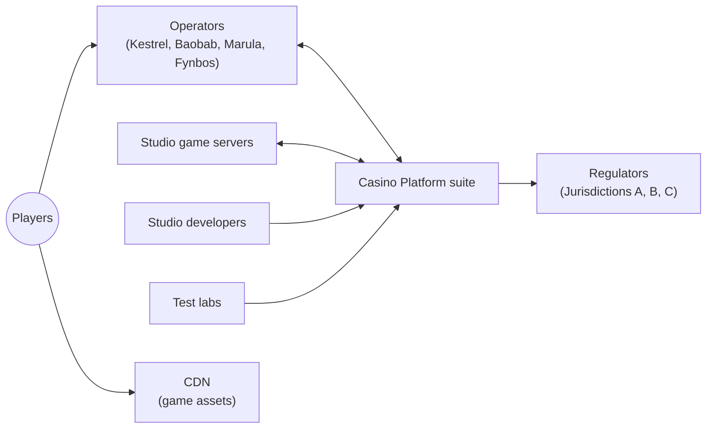
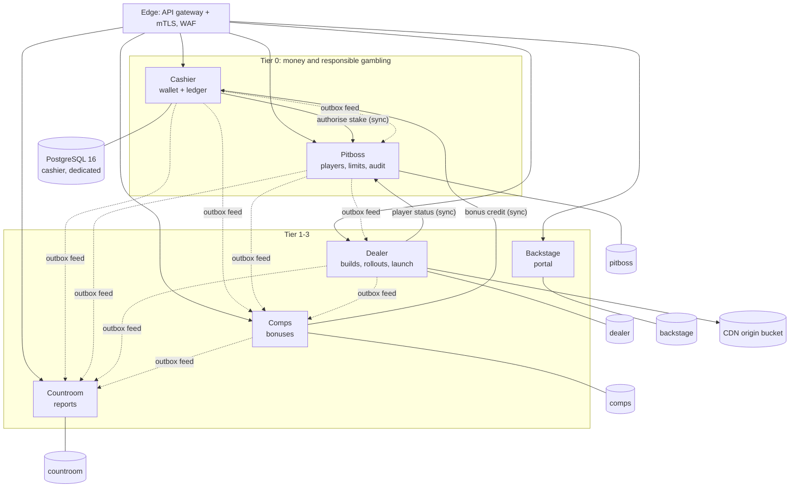
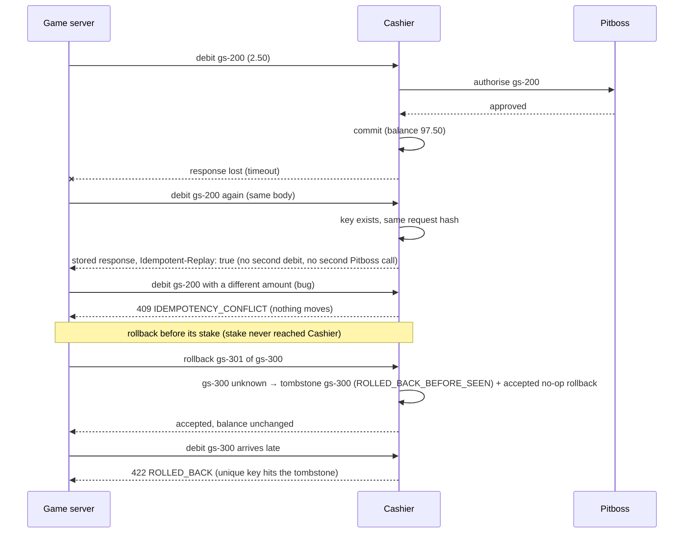
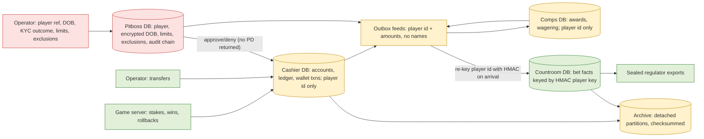
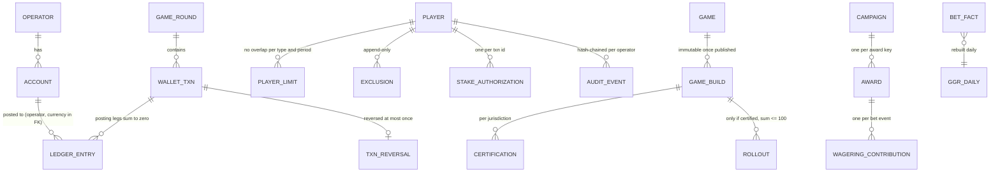

# Casino Platform: design dossier

A B2B suite supplied to casino operators and the game studios that publish onto it. Every company,
studio, person and jurisdiction here is invented. Read time: about 15 minutes.

Contents: 1 Brief · 2 Requirements · 3 Capacity · 4 Options · 5 Architecture · 6 Communication flows ·
7 Data flow · 8 Data model · 9 Scaling path · 10 Failure modes · 11 Security, privacy and compliance ·
12 Observability and incident drills · 13 Testing strategy and AI governance · 14 Interview questions

---

## 1. Brief
**Problem.** Operators (Kestrel Gaming, Baobab Casino, Marula Bet, Fynbos Play) can't offer many studios'
games across Jurisdictions A, B and C without each integration re-building wallet, responsible-gambling,
release and reporting rules. There is no shared, auditable platform between operators and game teams; it
costs months per integration and licence risk on every money or limit mistake.

**Users.** Operators (tenants, via APIs and reports), their players (~1.2 M monthly active), studios
(Ember Forge, Tidewater Studio, Quillon Games) and six platform teams, compliance officers, regulators
(receive sealed exports).

**Outcomes.** New game live for an operator in under 2 days; zero unexplained reconciliation
differences; zero stakes from excluded or over-limit players; wallet p99 < 150 ms at 2,000 bets/s;
regulator reports sealed by 06:00 local; kill switch effective in under 5 s.

## 2. Requirements
**Functional (slice 1 of each service, acceptance criteria in `services/<name>/.agentic/backlog.md`).**
| Service | Slice 1 |
|---|---|
| Cashier | Game server debits a stake and credits a win exactly once, only after Pitboss approves; the ledger balances. |
| Pitboss | Operator registers a player, sets a loss limit, self-excludes; authorisation approves or denies with a reason; all audited. |
| Dealer | Studio publishes a build; compliance certifies; release rolls out 10% to one operator; launch with a single-use token; kill switch. |
| Comps | Deposit match awarded once, credited to the separate bonus balance, wagering tracked from BetSettled, completes or expires. |
| Countroom | BetSettled becomes bet facts and daily GGR; operator downloads GGR; compliance seals an export. |
| Backstage | Team scaffolds a service from the golden path and sees its scorecard, including AI-governance checks. |

**Non-functional.**
| Quality | Target | Source |
|---|---|---|
| Wallet latency | p99 < 150 ms end to end incl. Pitboss (p99 < 50 ms) | studio integration contract |
| Wallet availability | 99.95% / 30 days (~22 min/month) | operator contracts |
| Launch | p95 < 300 ms, 99.9% | operator lobby budget |
| Report freshness | facts < 5 min behind settlement; daily report by 06:00 local | regulator deadlines |
| Durability | RPO 0 for money (synchronous standby), RTO < 15 min | ADR-0002 |
| Retention | audit and bet records 5–7 years per jurisdiction; raw events 30 days; launch sessions 30 days | `retention_policy`, jurisdiction rule sets |
| Privacy | minimum personal data; pseudonyms in reporting; erasure after retention | §11 |
| Tenancy | no operator can read or move another's data, proven by tests | ADR-0005, Pitboss RLS tests |

## 3. Capacity estimate
Assumptions (round generously): 1.2 M monthly active players; 60,000 concurrent at the evening peak; a
slot spin every 5 s for the ~10,000 players actively spinning at any instant, plus table games → **2,000
bets/s peak**; a peak-season day averages **1,000 bets/s** → **86 M rounds/day**.

| Quantity | Sum | Result |
|---|---|---|
| Wallet calls | 2 per round (debit + credit) × 86 M | **~173 M/day**, 4,000/s peak |
| Ledger entries | 2 per posting; ~60% of rounds lose, so ~1.4 postings per round | ~240 M entries/day |
| Ledger storage | 240 M × ~220 B (row + 3 indexes) | ~53 GB per peak day; ~1 TB/month average; **90 days hot ≈ 3 TB**, older months detached to the archive |
| `wallet_txn` (idempotency) | 173 M × ~380 B | ~66 GB per peak day; 90 days hot ≈ 1.5–2 TB |
| Cashier WAL | ~8 row writes per bet (txn, 2–4 entries, balance, round, outbox) → 16 k rows/s peak | ~30–40 MB/s WAL at peak: fits one 32-vCPU NVMe primary with ~2x headroom |
| Pitboss authorisations | 2,000/s peak, one insert + one usage update each | ~4 k writes/s; 90-day retention ≈ 0.6 TB |
| Events | Cashier 4,000/s peak (BetPlaced + BetSettled); others < 100/s | 3 Cashier consumers ≈ 12 k row reads/s on a hot partition |
| Countroom facts | 86 M/day × ~200 B | ~17 GB/day; GGR rows: ~4 operators × 3 jurisdictions × 400 games ≈ 5 k rows/day |
| Launches | 60 k concurrent ÷ 20-min sessions ≈ 50/s, peak 200/s | trivial for Dealer; CDN carries the weight |
| CDN egress | ~200 MB of new game assets per player per month | ~240 TB/month from the CDN, origin hit rate > 99% (content-addressed, immutable paths) |

## 4. Options considered
Suite traits: SeveralBusinessAreas, MoneyMovement, RegulatoryAudit, PersonalData, MultiTenant,
ExternalPartnerIntegrations, ComplexBusinessRules, GlobalScale. `arch-advisor compare` (full table in ADR-0001):

| Option | Fit | Complexity | Main reason |
|---|---|---|---|
| Microservices (request/response) | Recommended | 5 | Matches the advisor's recommended style (Microservices). |
| Event-driven microservices | Good alternative | 5 | Same family; valid if its trade-offs suit the team. |
| Modular monolith | Possible | 3 | Money: pair it with an append-only ledger and idempotency keys. |
| Modular monolith + CQRS read models | Possible | 3 | Same, plus read models. |
| Event-sourced core with CQRS | Possible | 4 | Same, plus replay. |
| Serverless functions + queues | Poor fit | 3 | Consistency-critical money is awkward across stateless functions. |
| Layered / vertical slice / Clean monolith | Poor fit | 1–2 | Several business areas would tangle. |

- **Chosen: microservices, hybrid of the two variants.** Synchronous only where an answer is needed before money moves (stake authorisation, launch, wallet, bonus credits); events for facts. The wallet's load is ~100x the portal's and its change process is stricter; six teams deploy independently.
- **Modular monolith** lost narrowly. It is what the advisor recommends for the same traits with a small team, and it would be cheaper. It loses on independent scaling of the wallet and on six teams sharing one release. Boundaries are contracts, so merging is cheap if the trigger fires.
- **Event-sourced core** lost: the append-only ledger and hash-chained audit already give the history; projections on the hot path cost latency.
- **Pure event-driven** lost: a stake can't wait for an eventually consistent view of exclusions.
- **Per service, at launch** the advisor recommends Clean Architecture (Cashier, Pitboss, Comps, Countroom), a layered monolith (Dealer: overridden to Clean for the certification gate; Backstage: accepted). At global scale it recommends further splitting (Microservices) for all but Backstage (modular monolith). Each service's ADR-0001 records the split it would make first.
- **Evolution trigger (ADR-0001):** teams spending more time on infrastructure than features → merge services that always change together (Comps into Cashier first). Under ~200 bets/s for a year → a modular monolith with a separate wallet.

## 5. Architecture
**C4 context**


**C4 containers**

Note: PDB to KDB share one PostgreSQL server pair with separate databases and roles; Cashier has its own (ADR-0002).

**What each owns and the contracts** (owners and sync/async table in `.agentic/architecture.md`):
| Service | Owns | Sync API (OpenAPI 3.1) | Publishes |
|---|---|---|---|
| Cashier | balances, rounds, wallet txns, ledger, reconciliation | wallet debit/credit/rollback, transfers, bonus credits | BetPlaced, BetSettled, RoundVoided, SettlementReversed |
| Pitboss | players, KYC, limits, exclusions, rule sets, decisions, audit | players, limits, exclusions, stake authorisations | LimitBreached, PlayerExcluded |
| Dealer | studios, builds, certifications, rollouts, kill switches, launches | builds, certifications, rollouts, launches, redeem, JWKS | GameReleased, GameKilled |
| Comps | campaigns, awards, wagering | campaigns, awards | BonusAwarded, BonusCompleted, BonusExpired |
| Countroom | bet facts, GGR/NGR, exports | reports, exports, ingestion status | none |
| Backstage | catalogue, templates, scorecards, prompts, change records | services, scorecards, prompts, eval runs, change records | none |

## 6. Communication flows
### 6.1 A full bet round
```mermaid
sequenceDiagram
  autonumber
  actor Pl as Player
  participant Op as Operator (Kestrel)
  participant De as Dealer
  participant Pi as Pitboss
  participant GS as Game server (Ember Forge)
  participant Ca as Cashier
  participant Co as Comps
  participant Cr as Countroom
  Pl->>Op: open "Jungle Reels" in lobby
  Op->>De: POST /v1/launches {player, game, JUR-A, EUR}
  De->>Pi: GET /v1/players/{id}/status (100 ms, fail closed)
  Pi-->>De: canPlay = true
  De->>De: resolve_build(bucket = hash(player) mod 100), check kill switches
  De-->>Op: launchUrl (CDN entrypoint + single-use token, 5 min)
  Pl->>GS: load game from CDN, present token
  GS->>De: POST /v1/launch-sessions/redeem {token}
  De-->>GS: game-session JWT (operator, player, JUR-A, EUR, build), signed ES256
  Pl->>GS: spin 2.50
  GS->>Ca: POST /v1/wallet/debit {txn gs-100, round r-1, 2.50} + JWT
  Ca->>Ca: verify JWT with cached JWKS; look up key (kestrel, gs-100): new
  Ca->>Pi: POST /v1/stake-authorizations {gs-100, 2.50} (150 ms budget)
  Pi->>Pi: rule set v3 + limits + exclusions → approved; store decision (key gs-100)
  Pi-->>Ca: approved, authorizationId
  Ca->>Ca: ONE transaction: wallet_txn + posting (player -250, house +250) + round open + outbox BetPlaced
  Ca-->>GS: accepted, balance 97.50
  GS->>Ca: POST /v1/wallet/credit {txn gs-101, round r-1, 6.00, closeRound}
  Ca->>Ca: ONE transaction: wallet_txn + posting (house -600, player +600) + round closed + outbox BetSettled
  Ca-->>GS: accepted, balance 103.50
  GS-->>Pl: show win
  Note over Ca: commit makes BetPlaced/BetSettled visible to the feed (tx_id below snapshot xmin)
  Co->>Ca: GET /v1/events?after=cursor (poll)
  Ca-->>Co: BetSettled r-1
  Co->>Co: ONE transaction: inbox(eventId) + wagering contribution (if active award)
  Cr->>Ca: GET /v1/events?after=cursor (poll)
  Ca-->>Cr: BetPlaced, BetSettled
  Cr->>Cr: raw_event; bet_fact (dedupe on eventId, business_date); nightly ggr_daily rebuild
  Pi->>Ca: GET /v1/events (poll)
  Ca-->>Pi: BetSettled → net-loss usage for limits
```
Idempotency keys: launch token (single use), `gs-100`/`gs-101` (Cashier and Pitboss), `eventId` (every consumer).
Outbox rows: steps 15 and 18, in the same transaction as the money.

### 6.2 Duplicate and late game-server callbacks

Proven by `services/cashier/db/tests/02_idempotency.sql` (duplicate key, tombstone, reverse-at-most-once).

### 6.3 Rollback after settlement
A game server may only roll back an **open** round. A settled round is corrected by an operator
adjustment with four-eyes approval, as a new reversing posting; the ledger is never edited.
```mermaid
sequenceDiagram
  participant GS as Game server
  participant Ca as Cashier
  participant Ops as Operator back office (two staff)
  participant Co as Comps
  participant Cr as Countroom
  participant Pi as Pitboss
  GS->>Ca: rollback gs-101 (win of closed round r-1)
  Ca-->>GS: 422 TXN_SETTLED
  Ops->>Ca: adjustment request: reverse gs-101, reason MALFUNCTION (maker)
  Ops->>Ca: approve (checker, different person)
  Ca->>Ca: ONE transaction: reversing posting (player -600, house +600, may not overdraw: if balance < 600, reverse what exists and open a receivable), txn_reversal row, round closed→voided, outbox SettlementReversed
  Ca-->>Ops: done
  Co->>Ca: poll → SettlementReversed: hold award for manual review (progress is never decremented automatically)
  Cr->>Ca: poll → restate business day; re-run ggr_daily; supersede any sealed export for that day
  Pi->>Ca: poll → adjust net-loss usage
```

### 6.4 Limit breach mid-session
```mermaid
sequenceDiagram
  participant GS as Game server
  participant Ca as Cashier
  participant Pi as Pitboss
  participant Op as Operator
  Note over Pi: daily loss limit 50.00, net loss so far 49.00
  GS->>Ca: debit gs-400 (2.50)
  Ca->>Pi: authorise gs-400
  Pi->>Pi: 49.00 + 2.50 > 50.00 → denied LOSS_LIMIT; outbox LimitBreached
  Pi-->>Ca: denied
  Ca->>Ca: store rejected wallet_txn (replayable)
  Ca-->>GS: 422 LIMIT_REACHED
  GS->>Ca: credit gs-401 for the round already in play
  Ca-->>GS: accepted (wins are never blocked by limits)
  Op->>Pi: poll → LimitBreached → show the player a limit message, offer tools
```
Self-exclusion mid-session works the same way: the next stake is denied `EXCLUDED`, Dealer revokes open
launch sessions on PlayerExcluded, Comps forfeits active bonuses, and open rounds still settle.

### 6.5 Wallet unavailable
| Case | Behaviour |
|---|---|
| Cashier down or slow (debit) | Game server retries the **same** transaction id with backoff for up to 30 s; if the outcome is still unknown it sends a rollback for that id (a tombstone if the debit never landed). The player sees "connection problem", never a double charge. |
| Cashier down (credit/rollback) | Game server keeps the credit in its outbox and retries until accepted (integration contract: up to 72 h). Cashier never refuses a credit for limits, so a retry always lands. |
| Cashier health red | Dealer stops issuing launches for affected operators (circuit), so no new sessions start. |
| Pitboss down | Cashier rejects stakes `RG_UNAVAILABLE` (fail closed); wins and rollbacks continue. |
| Operator wallet down (pass-through mode, later slice) | Stakes rejected; credits go to Cashier's store-and-forward queue and are pushed to the operator when it recovers; reconciliation shows them as in transit. |

## 7. Data flow

Red = personal data, green = money, yellow = both (money keyed by a pseudonymous player id).
Personal data enters only at Pitboss; names, addresses and documents never leave the operator.
Money enters only at Cashier. Countroom never stores the platform player id, only an HMAC with a key held
by Countroom (re-identification for a regulator request goes through Pitboss, audited).

Layers in Countroom (data-flows skill): `raw_event` (exactly as received, 30 days) → `bet_fact` (typed,
de-duplicated, quarantine for rejects) → `ggr_daily` (rebuilt by a re-runnable job, `job_run` lineage).
Reconciliation after each rebuild: model totals = clean-layer totals (tested), and daily GGR = Cashier's
house-account net for the day.

## 8. Data model

(Each cluster lives in a different database; lines across services are logical, carried by ids in events, never by foreign keys.)

| Entity | Owner | Consistency rule |
|---|---|---|
| account balance, ledger, wallet txn, round | Cashier | strong (one transaction per wallet call; deferred zero-sum check at commit) |
| stake decision, limits, exclusions, audit | Pitboss | strong within Pitboss; Cashier sees it synchronously |
| net-loss usage | Pitboss | eventual (from BetSettled, seconds); the wager limit is strong (counted at authorisation) |
| builds, certification, rollouts, kill switch | Dealer | strong; launch nodes cache rollouts ≤ 5 s |
| award state, wagering progress | Comps | eventual from BetSettled (p99 < 60 s); bonus money strong in Cashier |
| bet facts, GGR | Countroom | eventual (< 5 min); daily rebuild is the reportable truth |

Database inventory (verified): 6 databases, **58 tables** (+3 views), partitioned tables:
Cashier `ledger_entry` (monthly), `outbox` (daily), `wallet_txn` and `game_round` (16 hash partitions
each); Countroom `bet_fact` and `raw_event` (daily); Dealer `launch_session` (daily).

## 9. Scaling path (what breaks first, in order)
1. **Cashier write throughput and the idempotency table.** First pressure at ~50% of the primary's WAL
   or CPU. Before that: keep 90 days hot, archive older ledger months and keys; read replicas for
   balance reads and feed polling.
2. **Operator shards (cells)**: run N copies of Cashier, each with its own database, routing by
   `operator_code` (already in every key and FK). A big operator gets its own cell. No cross-cell
   transactions are needed because money never crosses operators.
3. **Take Pitboss off the per-bet path**: a stake-allowance lease. Pitboss grants Cashier a short-lived
   (60 s) signed budget per player session = min(remaining limits); Cashier debits against it locally
   and renews early; PlayerExcluded revokes leases immediately (push + short TTL). Removes one hop from
   the p99.
4. **Broker behind the outboxes** (ADR-0003 trigger): the outbox relay publishes to a log-based broker;
   consumers move from polling to subscriptions; the outbox stays for atomicity.
5. **Countroom to a columnar store** for multi-year analytics; `ggr_daily` stays in PostgreSQL.
6. **Regional cells for data residency**: a jurisdiction's operators, players and money live in-region;
   Dealer's catalogue and Backstage stay global; Countroom exports per region.
7. **Dealer launch at the edge**: launch reads a pushed rollout snapshot in each region; CDN already global.

## 10. Failure modes
| Failure | Effect | Mitigation |
|---|---|---|
| Duplicate game-server request | could debit twice | unique key `(operator, txn id)`, stored response replay, 409 on mismatch (§6.2) |
| Rollback before stake | stake lands after rollback | tombstone row; late stake hits the unique key |
| Rollback after settlement | money reversed silently | refused (`TXN_SETTLED`); operator adjustment with four-eyes; SettlementReversed (§6.3) |
| Pitboss down | stakes from excluded players if failing open | fail closed `RG_UNAVAILABLE`; wins continue; alert; drill D1 |
| Cashier primary fails | wallet down | synchronous standby, automatic failover < 60 s, RPO 0; game servers retry same ids |
| Unbalanced posting from a code bug | books don't balance | deferred zero-sum trigger rolls back the whole transaction; alert on any 23514 |
| Missing partition | inserts fail at midnight / month end | daily job keeps 30 days / 3 months ahead; alert when < 7 days / 2 months; tested |
| Consumer poison event | consumer stuck, lag grows | park the event with reason after 5 attempts, continue, alert; replay after fix |
| Slow commit in outbox | consumer skips an event | `(tx_id, position)` cursor below snapshot xmin (ADR-0003) |
| Hot house account row | lock contention at peak | house accounts keep no running balance (sum of entries) |
| Hot player (bot, very fast spins) | serialised on the player's balance row | expected and correct; per-player rate limit at the gateway |
| Operator wallet down (pass-through) | stakes fail, credits pending | stakes refused; credits store-and-forward; reconciliation "in transit" |
| Game paying wrongly | money loss | kill switch < 5 s; void open rounds; certification revocation rolls back rollouts in one transaction |
| Region outage | operators in region down | cell per region with standby in a second zone; cross-region DR with RPO ≤ 1 min for non-money, 0 for money within region |
| Reconciliation mismatch | regulator finding | daily run per operator/currency; mismatch freezes adjustments for that operator and pages team-cashier |

## 11. Security, privacy and compliance
**AuthN/AuthZ.** mTLS for every machine caller; the tenant comes from the client certificate. Game
servers additionally present Dealer's game-session JWT (ES256, ≤ 12 h, keys rotated every 30 days via
JWKS), which binds operator, player, jurisdiction, currency, game and build: a game server can only move
money for the session it was given. Staff use OIDC with roles; money adjustments need maker and checker.
Pitboss enforces tenancy again in the database (RLS); Cashier carries the operator in composite FKs.

**STRIDE per main flow**
| Flow | Threat | Control |
|---|---|---|
| Launch | **S**poofing: reuse a launch URL | random 256-bit token, hash stored only, single use, ≤ 5 min (DB check) |
| Launch | **E**levation: launch an uncertified or killed build | `resolve_build` joins certification and kill switches; DB rejects uncertified rollouts |
| Wallet debit/credit | **T**ampering: change amount on retry | request hash stored; mismatch → 409 |
| Wallet debit/credit | **S**poofing: game server acts for another operator or player | mTLS identity + session JWT claims must match request; tenant in FK |
| Wallet debit/credit | **R**epudiation: "we never sent that win" | stored request hash, response and trace id per transaction; append-only ledger |
| Wallet debit/credit | **D**enial of service: retry storm | per-studio rate limits, idempotent replays are cheap (index lookup), circuit breaker in game-server SDK |
| Limits and exclusions | **T**ampering: shorten an exclusion | append-only table, no API to shorten, trigger rejects UPDATE/DELETE |
| Limits and exclusions | **R**epudiation: "the player never asked" | hash-chained audit with actor, tamper detection even against a DBA (tested) |
| Studio publish | **T**ampering: swap assets after certification | content-addressed asset paths, manifest SHA-256 stored, published builds immutable (DB) |
| Reports and exports | **I**nformation disclosure: operator sees another's GGR | tenant from mTLS, query scoped, pseudonymous player keys only |
| Reports and exports | **T**ampering: alter a filed report | sealed export with SHA-256; immutable; corrections supersede, never overwrite |
| Event feeds | **I**nformation disclosure | service mTLS only; events carry pseudonymous ids, no names or DOB (schema rejects extra fields) |

**Privacy (GDPR/POPIA-style).** Minimum data: operator player ref, jurisdiction, KYC outcome, age flag,
application-encrypted DOB (key in the vault, per-operator data keys). No personal data in logs or events.
Countroom re-keys player ids with HMAC. Access to Pitboss player records is audited. Erasure requests:
regulated records must be kept for the retention period, so the platform restricts processing and
deletes or irreversibly pseudonymises after retention ends (scheduled per jurisdiction).

**Regulated-market compliance**
| Requirement | How |
|---|---|
| Full audit | append-only ledger and wallet txns; hash-chained Pitboss audit; rule-set version stored on every stake decision |
| Retention | per jurisdiction (`retention_policy`, jurisdiction `audit_retention` 5–7 years); partitions detached and archived with checksums, never silently dropped |
| Responsible gambling | limits (deposit, loss, wager, session), increases delayed per jurisdiction, cool-off and self-exclusion (≥ 6 months or indefinite) that can't be shortened, reality checks every 5–120 min, fail-closed authorisation |
| Jurisdiction rules | versioned rule sets that cannot overlap in time (exclusion constraint); min age, min RTP (DB check on certification) |
| Certification | build-level certificates; rollouts impossible without one; revocation pulls rollouts in the same transaction |
| Change management | CODEOWNERS, four-eyes on tier-0 migrations, AI-assisted changes need human review (and critic review on tier 0), recorded in Backstage |
| Regulator reporting | daily sealed exports by 06:00 local; corrections supersede |

**Secrets.** Vault-issued, short-lived database credentials; OIDC federation for CI; no secrets in the
repo (privacy guard and secret scan in CI).

## 12. Observability and incident drills
**SLOs per service**
| Service | SLI | SLO | Page when |
|---|---|---|---|
| Cashier | non-5xx wallet responses | 99.95% / 30 d | 2% of monthly budget burned in 1 h |
| Cashier | wallet p99 latency | < 150 ms | p99 > 150 ms for 10 min |
| Cashier | unbalanced-posting rejections | 0 | any |
| Cashier | reconciliation | 100% of operator-days matched or explained by 12:00 | any unexplained mismatch |
| Pitboss | authorisation success / p99 | 99.95% / < 50 ms | burn-rate as Cashier |
| Dealer | launch success / p95 | 99.9% / < 300 ms | burn-rate |
| Dealer | kill-switch propagation | < 5 s | > 5 s in drill or prod |
| Comps | BetSettled → progress lag | p99 < 60 s | > 5 min |
| Countroom | freshness; report deadline | < 5 min; 06:00 local 99% of days | freshness > 15 min; report not sealed at 05:00 |
| Backstage | availability | 99.5% business hours | ticket only |

**Signals.** Traces (OpenTelemetry) from the game-server call through Cashier, Pitboss and PostgreSQL;
`traceparent` copied into outbox events so consumer work joins the trace. Metrics: wallet calls by
outcome and reject code, idempotent replays, Pitboss deny reasons, consumer lag per feed (cursor age),
partitions ahead, outbox size, recon differences. Dashboards show "data as of".

**The alert that wakes someone:** wallet error-budget fast burn, any unbalanced posting, Pitboss
unavailable (stakes being refused), reconciliation mismatch, kill switch failing to propagate.

**Incident drill plan** (staging monthly, production game-day quarterly; each has an owner and a pass criterion)
| # | Drill | Inject | Pass when |
|---|---|---|---|
| D1 | Pitboss unavailable | block Cashier → Pitboss | stakes rejected `RG_UNAVAILABLE` within 150 ms; wins continue; page fires < 2 min; no stake accepted without authorisation (audit query) |
| D2 | Cashier primary failover | kill the primary at 1,500 bets/s | failover < 60 s; zero lost or duplicated postings (zero-sum and replay check); game servers recover with same ids |
| D3 | Duplicate-callback storm | replay 1 h of wallet traffic twice | balances unchanged; all replays flagged `Idempotent-Replay`; p99 stays < 150 ms |
| D4 | Poison event | publish an event that breaks the Comps consumer | event parked with reason after 5 tries; lag recovers; replay after fix applies once |
| D5 | Bad game build | studio reports a payout bug | kill switch < 5 s; open rounds voided by runbook; certification revoked → rollouts rolled back; GameKilled consumed |
| D6 | Reconciliation mismatch | inject a missing credit in an operator file | mismatch detected at the daily run; adjustments frozen; root cause found from `wallet_txn` by transaction id |
| D7 | Consumer 2-day outage | stop Countroom for 48 h | catches up from the feed within 2 h; GGR identical to a clean run; no duplicates |

## 13. Testing strategy and AI-assisted engineering governance
| Layer | What it proves here | Where |
|---|---|---|
| Unit (rules) | posting builder, round state machine, idempotency decisions, jurisdiction rule tables, rollout buckets, wagering weighting, GGR maths | each service, every push |
| Database | the invariants that must never break: zero-sum postings, unique keys, append-only, no overlapping limits/rule sets, certification gate, tenant isolation, partitions, sealed exports | `services/*/db/tests/*.sql`, `tools/db-verify.sh` (**175 assertions passing** on PostgreSQL 16) |
| Integration (seams) | each service against real PostgreSQL (Testcontainers), concurrent duplicate requests, Pitboss client timeouts | each service |
| Contract | event schemas and examples, OpenAPI 3.1 validity; producers validate outgoing events; consumers replay `contracts/events/examples`; Cashier ↔ Pitboss authorisation tested against Pitboss's OpenAPI | `tools/validate-contracts.py`, consumer test suites |
| Property | random sequences of debit/credit/rollback/retry keep `sum(ledger) = 0` and balance = sum of player entries | Cashier |
| End to end | the §6.1 round against docker-compose with a fake game server: one BetSettled, one bet fact, one GGR row, wagering progress, ledger zero-sum | suite e2e, every PR touching contracts |
| Load | 2,000 bets/s for 30 min with p99 < 150 ms; 4,000 events/s feed with 3 consumers | weekly, before releases |
| Drills | §12 | monthly |

Acceptance criteria map to tests one to one: each criterion in a service backlog names the test that
proves it (for example Cashier AC2 "replay" = integration test + `02_idempotency.sql`).

**AI-assisted engineering governance** (the kit's Baton model, enforced through Backstage):
- Each service has its own `.agentic/` so an agent loads only that service's context; suite rules live at the root.
- Every merged change is recorded (`change_record`): AI-assisted changes need a human reviewer who is not the author; tier-0 services (Cashier, Pitboss) also need the fresh-context critic agent's review. The database rejects a record that breaks these rules, and the merge bot blocks the merge.
- Prompts used in production are registered (`prompt_version`), hashed and owned; approval needs an eval run of at least 20 cases at or above the threshold; approved versions are immutable.
- Scorecards per team: tests, coverage ratchet, DB tests, SLO budget, security findings, AI review coverage, critic coverage, prompt registry, Baton freshness.
- CI gates: privacy guard, secret scan, dependency scan, contract validation, db-verify, coverage ratchet.

## 14. Interview questions
1. **What happens if the game server sends the same debit twice?** The second hits the unique key
   `(operator, game_server_txn_id)`; same request hash → we return the stored response with
   `Idempotent-Replay: true`, without calling Pitboss again; different hash → 409. Rejections are stored
   too, so a retried stake can't flip from rejected to accepted.
2. **And if the rollback arrives before the stake?** We write a tombstone for the unseen stake id and
   accept the rollback as a no-op. When the stake arrives it collides with the tombstone and is refused.
3. **How do you guarantee the books balance?** Every money movement is a posting whose entries sum to zero
   per currency, enforced by a deferred constraint trigger at commit; entries are append-only; operator and
   currency are part of the foreign key to the account; player balances can't go negative. All proven by DB tests.
4. **Why does Cashier call Pitboss synchronously on every bet, and what if Pitboss is down?** A stake from an
   excluded player must be impossible, so the check must be current: synchronous, 150 ms budget, fail
   closed. Wins and rollbacks never depend on Pitboss. At scale, a short-lived stake-allowance lease
   removes the per-bet hop without weakening the guarantee.
5. **Why no message broker?** The outbox is required anyway for atomic publishing; at 4,000 events/s and
   three consumers PostgreSQL serves the feed cheaply, replay is free, and there's one less tier-0 system.
   The trigger to add one is in ADR-0003 (consumers, replay window, cross-region).
6. **How can a polling consumer miss an event, and how do you prevent it?** Sequence values are assigned at
   insert but visible at commit, so a slow transaction can commit a lower position after the consumer moved
   past it. The cursor is `(tx_id, position)` and the feed only serves rows from transactions older than the
   snapshot's xmin.
7. **How do you keep idempotency keys unique on a partitioned table?** A unique index on a partitioned table
   must include the partition key, so `wallet_txn` is hash-partitioned on the key itself. Countroom uses
   `(event_id, business_date)` because the event fixes its business date.
8. **How do you scale the wallet 10x?** Archive and read replicas first, then operator cells (money never
   crosses operators, and `operator_code` is already in every key), then the allowance lease to drop the
   Pitboss hop. A distributed database is the last resort, not the first.
9. **How do you make sure an uncertified game is never served?** Certification is per build and
   jurisdiction; the database rejects an active rollout without a certificate and rolls rollouts back in the
   same transaction as a revocation; launch resolves the build through certification and kill switches.
10. **How do you govern AI-written code on a money system?** Every change is recorded; AI-assisted changes
    need a human reviewer who isn't the author, and on tier-0 services also the critic agent; prompts are
    registered with eval gates; the rules are database constraints so no tool can skip them; and the
    invariants that matter most are enforced by PostgreSQL itself, so a plausible-looking bug still can't
    unbalance the ledger.

**Assumptions to confirm with operators:** share of operators wanting pass-through vs hosted wallets; exact
retention per jurisdiction; whether any jurisdiction requires a national self-exclusion register check at
registration; studio ability to send time-ordered transaction ids (UUIDv7/ULID).
