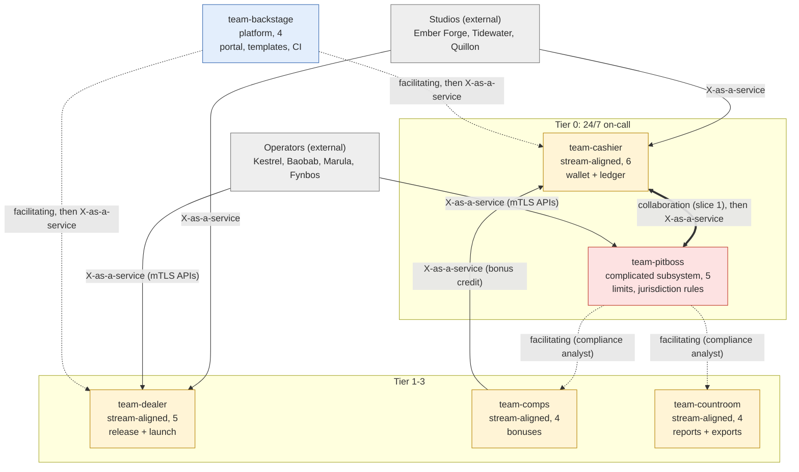

# Team topology

Six notional teams (all invented), each owning one service end to end: code, database, on-call,
`.agentic/` baton and its slice of the contracts. Team types follow the four common team types
(stream-aligned, platform, enabling, complicated-subsystem) and three interaction modes
(collaboration, X-as-a-service, facilitating).

## Teams
| Team | Type | Size | Owns | Its API to other teams | On-call |
|---|---|---|---|---|---|
| team-cashier | stream-aligned (money flow) | 6 | `services/cashier` | wallet API (studios), transfers (operators), bonus credits (Comps), event feed | 24/7, tier 0 |
| team-pitboss | complicated subsystem (jurisdiction rules) | 5 incl. a compliance analyst | `services/pitboss` | stake authorisation (Cashier), player status (Dealer), players/limits/exclusions (operators), event feed | 24/7, tier 0 |
| team-dealer | stream-aligned (studio and operator journey) | 5 | `services/dealer` | builds, certifications, rollouts, launches, kill switch, JWKS, event feed | 24/7, tier 1 |
| team-comps | stream-aligned (operator CRM journey) | 4 | `services/comps` | campaigns, awards, event feed | business hours + escalation |
| team-countroom | stream-aligned (finance and compliance journey) | 4 | `services/countroom` | reports, exports, ingestion status | business hours; 05:00 local report watch |
| team-backstage | platform | 4 | `services/backstage`, `tools/`, golden-path templates, CI | portal, templates, scorecards, test harness (`tools/sql/test_helpers.sql`, `tools/db-verify.sh`) | business hours |

Studios (Ember Forge, Tidewater Studio, Quillon Games) are external stream-aligned teams: they consume
Dealer and Cashier as a service and Backstage's `game-server-adapter` template.

## Interaction modes

Yellow = stream-aligned, red = complicated subsystem, blue = platform, grey = external teams. Operators also use Cashier, Comps and Countroom as a service, and Backstage facilitates every team (table below); the diagram shows one edge of each to stay readable.

| Between | Mode | What it looks like | Changes to |
|---|---|---|---|
| Cashier ↔ Pitboss | **collaboration** during slice 1 (the authorisation contract, fail-closed rule, latency budget) | shared design sessions, joint drill D1 | X-as-a-service once the contract is stable (after slice 1) |
| Studios → Cashier, Dealer | X-as-a-service | OpenAPI + SDK from the template + certification checklist | stays |
| Operators → Dealer, Pitboss, Cashier, Comps, Countroom | X-as-a-service | mTLS APIs, webhooks for events | stays |
| Comps → Cashier | X-as-a-service | idempotent bonus-credit API | stays |
| All consumers → event producers | X-as-a-service | `contracts/events`, feed API, versioning rules | stays |
| Backstage → all teams | **facilitating** for adoption, then X-as-a-service | pairs with a team to adopt a template or a scorecard check, then steps back | X-as-a-service per capability |
| Pitboss compliance analyst → Comps, Countroom | facilitating | jurisdiction rules walkthroughs, report reviews | time-boxed |

## Managing cognitive load
- **One service, one domain language per team.** Cashier talks postings and rounds, Pitboss talks limits and exclusions; no team needs the other's internals.
- **Thin, explicit contracts.** A team only needs to know the APIs and event schemas it uses (`contracts/README.md` lists every producer and consumer).
- **Golden path instead of choices.** Backstage's template brings CI, outbox, feed, DB-test harness, telemetry and the Baton; a stream-aligned team does not decide how to do these.
- **Complicated subsystem where expertise is rare.** Jurisdiction rules are concentrated in Pitboss with a compliance analyst, so Comps and Dealer ask "may this player play?" instead of learning three rulebooks.
- **Per-service baton.** Each `services/<name>/.agentic/` holds only that team's context; humans and agents load the small thing, not the whole suite.
- **Tiering.** Tier-0 rules (four-eyes migrations, critic review on AI changes, 24/7 on-call) apply only to Cashier and Pitboss.

## Managing autonomy
- **Independent deploys** (ADR-0004): path-filtered CI, a pipeline per service, no release train.
- **Own data** (ADR-0002): no team can be broken by another team's schema change.
- **Own decisions**: per-service ADRs; suite ADRs only for cross-cutting rules (money, events, databases, repo).
- **Guardrails, not gates**: CODEOWNERS, contract validation and DB tests catch cross-team breakage automatically; a team doesn't need permission to ship within its boundary.
- **Contract changes are the one negotiated thing**: producer plus every listed consumer approves; breaking changes dual-publish (contracts/README.md).

## Signals that the topology needs to change
- Comps and Cashier change together in most releases → merge Comps into Cashier's team (ADR-0001 trigger).
- Pitboss becomes a bottleneck for every new jurisdiction → add a second complicated-subsystem team per region.
- Backstage requests queue for weeks → the platform team is under-sized or the golden path is too narrow.
