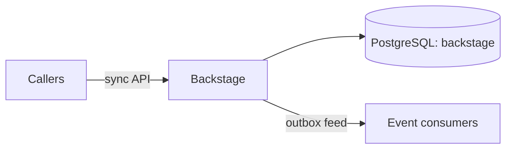

# Backstage

Owner: `team-backstage` · Tier 3 · Casino Platform suite (invented operators, studios and jurisdictions).

Developer portal for platform teams and game studios: golden-path templates that come with the kit's Baton (`.agentic/`), CI, OpenAPI stub, migrations with DB tests, outbox and telemetry; a service catalogue; scorecards per team (tests, coverage, SLOs, security, AI governance: review coverage, critic reviews, prompt registry, eval gates); onboarding.

## Design at a glance
- **Style**: advisor says **LayeredMonolith** at launch and **ModularMonolith** at global scale. Decision and judgement: `.agentic/decisions/0001-service-architecture.md`.
- **Slice 1**: A team scaffolds a new service from the golden path and sees its scorecard filled by CI, including AI-governance checks. (acceptance criteria in `.agentic/backlog.md`).
- **API** (`api/openapi.yaml`, OpenAPI 3.1): `GET/POST /v1/services`, `GET /v1/services/{code}/scorecard`, `POST /v1/scorecard-results`, `POST /v1/prompts`, `POST /v1/eval-runs`, `POST /v1/change-records`.
- **Calls**: forge API (open the scaffold pull request).
- **Publishes**: none in slice 1. **Consumes**: GameReleased (catalogue of live games, later). Schemas in `contracts/events/`.
- **Database** (`db/migrations/V001__init.sql`, PostgreSQL 16, own database `backstage`):

| Table | Notes |
|---|---|
| `team` |  |
| `template` |  |
| `service` |  |
| `service_dependency` |  |
| `scorecard_check` |  |
| `scorecard_result` |  |
| `prompt_version` |  |
| `eval_run` |  |
| `change_record` |  |
| `onboarding_task` |  |
| `onboarding_progress` |  |
| `views: scorecard_latest, team_score, ai_review_coverage` |  |

- **Proof**: `db/tests/*.sql` assert the constraints (run `tools/db-verify.sh` from the repo root).

