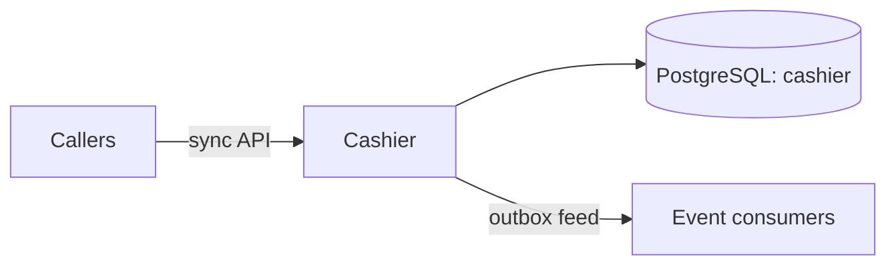

# Cashier

Owner: `team-cashier` · Tier 0 · Casino Platform suite (invented operators, studios and jurisdictions).

Seamless wallet and bet ledger. Studio game servers debit stakes, credit wins and roll back; operators transfer money into hosted wallets; Comps moves bonus money. Every call is idempotent on the caller's transaction id and lands in a double-entry, append-only ledger.

## Design at a glance
- **Style**: advisor says **CleanArchitecture** at launch and **Microservices** at global scale. Decision and judgement: `.agentic/decisions/0001-service-architecture.md`.
- **Slice 1**: A game server can debit a stake and credit a win for a player in a hosted wallet, exactly once, only after Pitboss approves, and the ledger balances. (acceptance criteria in `.agentic/backlog.md`).
- **API** (`api/openapi.yaml`, OpenAPI 3.1): `GET /v1/wallet/balance`, `POST /v1/wallet/debit`, `POST /v1/wallet/credit`, `POST /v1/wallet/rollback`, `POST /v1/transfers`, `POST /v1/bonus-credits`, `GET /v1/events`.
- **Calls**: Pitboss `POST /v1/stake-authorizations` (sync, 150 ms, fail closed); Dealer JWKS (cached).
- **Publishes**: BetPlaced, BetSettled, RoundVoided, SettlementReversed. **Consumes**: GameKilled (void open rounds of a killed game after a grace period). Schemas in `contracts/events/`.
- **Database** (`db/migrations/V001__init.sql`, PostgreSQL 16, own database `cashier`):

| Table | Notes |
|---|---|
| `currency` |  |
| `operator` |  |
| `account` |  |
| `game_round` | 16 hash partitions |
| `wallet_txn` | 16 hash partitions |
| `txn_reversal` |  |
| `ledger_entry` | monthly range partitions |
| `recon_run` |  |
| `outbox` | daily range partitions |

- **Proof**: `db/tests/*.sql` assert the constraints (run `tools/db-verify.sh` from the repo root).

