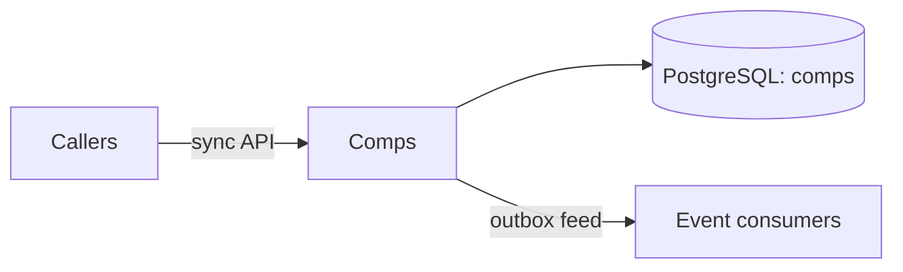

# Comps

Owner: `team-comps` · Tier 1 · Casino Platform suite (invented operators, studios and jurisdictions).

Bonus engine: deposit-match and free-spin campaigns, awards that are idempotent per triggering fact, wagering requirements tracked from BetSettled events and weighted by game category, expiry, and a bonus balance kept separate from cash (the money sits in Cashier; Comps owns rules and state).

## Design at a glance
- **Style**: advisor says **CleanArchitecture** at launch and **Microservices** at global scale. Decision and judgement: `.agentic/decisions/0001-service-architecture.md`.
- **Slice 1**: A deposit-match bonus is awarded once per deposit, credited to the separate bonus balance, tracks wagering from BetSettled and completes or expires. (acceptance criteria in `.agentic/backlog.md`).
- **API** (`api/openapi.yaml`, OpenAPI 3.1): `POST /v1/campaigns`, `POST /v1/awards`, `GET /v1/players/{id}/awards`, `GET /v1/events`.
- **Calls**: Cashier `POST /v1/bonus-credits` (idempotent on awardId + operation); Pitboss status before awarding.
- **Publishes**: BonusAwarded, BonusCompleted, BonusExpired. **Consumes**: BetSettled, SettlementReversed (hold award for review), PlayerExcluded, GameReleased, GameKilled. Schemas in `contracts/events/`.
- **Database** (`db/migrations/V001__init.sql`, PostgreSQL 16, own database `comps`):

| Table | Notes |
|---|---|
| `campaign` |  |
| `game_contribution` |  |
| `award` |  |
| `free_spin_grant` |  |
| `wagering_contribution` | append-only, unique per bet event |
| `outbox` |  |
| `inbox` |  |
| `consumer_checkpoint` |  |

- **Proof**: `db/tests/*.sql` assert the constraints (run `tools/db-verify.sh` from the repo root).

