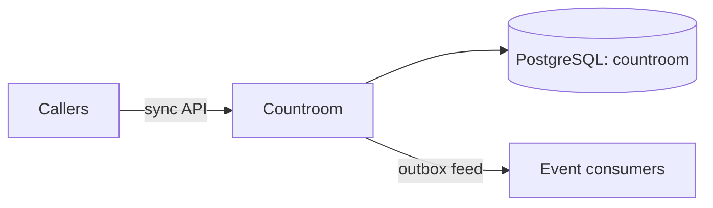

# Countroom

Owner: `team-countroom` · Tier 2 · Casino Platform suite (invented operators, studios and jurisdictions).

Bet and GGR/NGR reporting per operator, game and jurisdiction, built from events. Raw events are landed as received, cleaned into de-duplicated bet facts in daily partitions, and modelled into daily GGR by a re-runnable job. Regulator exports are sealed with a checksum; retention follows each jurisdiction.

## Design at a glance
- **Style**: advisor says **CleanArchitecture** at launch and **Microservices** at global scale. Decision and judgement: `.agentic/decisions/0001-service-architecture.md`.
- **Slice 1**: BetSettled events from Cashier become bet facts and a daily GGR row; Kestrel downloads the day's GGR, and compliance seals a regulator export. (acceptance criteria in `.agentic/backlog.md`).
- **API** (`api/openapi.yaml`, OpenAPI 3.1): `GET /v1/reports/ggr-daily`, `POST /v1/exports`, `GET /v1/exports/{id}`, `GET /v1/ingestion/status`.
- **Calls**: none synchronous.
- **Publishes**: none (it is the end of the line; exports go to regulators). **Consumes**: BetPlaced, BetSettled, RoundVoided, SettlementReversed, LimitBreached, PlayerExcluded, GameReleased, GameKilled, BonusAwarded, BonusCompleted, BonusExpired. Schemas in `contracts/events/`.
- **Database** (`db/migrations/V001__init.sql`, PostgreSQL 16, own database `countroom`):

| Table | Notes |
|---|---|
| `raw_event` | daily partitions |
| `bet_fact` | daily partitions |
| `ingest_quarantine` |  |
| `ggr_daily` | generated GGR/NGR |
| `job_run` |  |
| `report_export` | sealed |
| `retention_policy` |  |
| `consumer_checkpoint` |  |

- **Proof**: `db/tests/*.sql` assert the constraints (run `tools/db-verify.sh` from the repo root).

