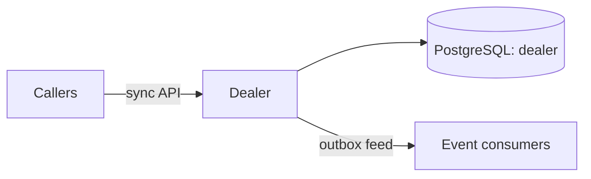

# Dealer

Owner: `team-dealer` · Tier 1 · Casino Platform suite (invented operators, studios and jurisdictions).

Game catalogue and launch for game teams: studios publish immutable, versioned builds (manifest + CDN assets), compliance records certification per jurisdiction, release managers roll builds out per operator by percentage, on-call can kill a game in seconds, operators launch games with a signed, short-lived token, and game health telemetry shows whether a build is healthy.

## Design at a glance
- **Style**: advisor says **LayeredMonolith** at launch and **Microservices** at global scale. Decision and judgement: `.agentic/decisions/0001-service-architecture.md`.
- **Slice 1**: A studio publishes a build, compliance certifies it for Jurisdiction A, release rolls it out to Kestrel Gaming at 10%, Kestrel launches it and the game server redeems the token; the kill switch stops new launches. (acceptance criteria in `.agentic/backlog.md`).
- **API** (`api/openapi.yaml`, OpenAPI 3.1): `POST /v1/games/{gameCode}/builds`, `POST /v1/builds/{buildId}/certifications`, `POST /v1/rollouts`, `POST /v1/launches`, `POST /v1/launch-sessions/redeem`, `POST /v1/kill-switches`, `GET /.well-known/jwks.json`, `GET /v1/events`.
- **Calls**: Pitboss `GET /v1/players/{id}/status` on launch (100 ms, fail closed).
- **Publishes**: GameReleased, GameKilled. **Consumes**: PlayerExcluded (revoke the player's open launch sessions). Schemas in `contracts/events/`.
- **Database** (`db/migrations/V001__init.sql`, PostgreSQL 16, own database `dealer`):

| Table | Notes |
|---|---|
| `studio` |  |
| `jurisdiction` | min RTP |
| `game` |  |
| `game_build` | immutable once published |
| `certification` |  |
| `rollout` | deferred validity check |
| `kill_switch` |  |
| `launch_session` | daily partitions |
| `game_health_minute` |  |
| `outbox` |  |

- **Proof**: `db/tests/*.sql` assert the constraints (run `tools/db-verify.sh` from the repo root).

