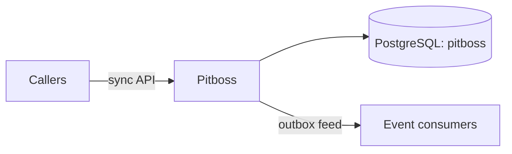

# Pitboss

Owner: `team-pitboss` · Tier 0 · Casino Platform suite (invented operators, studios and jurisdictions).

Player accounts and responsible gambling: KYC status, deposit/loss/wager/session limits, cool-off and self-exclusion, per-jurisdiction rule sets, reality checks, and a tamper-evident audit log. Cashier asks Pitboss before accepting every stake.

## Design at a glance
- **Style**: advisor says **CleanArchitecture** at launch and **Microservices** at global scale. Decision and judgement: `.agentic/decisions/0001-service-architecture.md`.
- **Slice 1**: An operator registers a player, sets a loss limit and can self-exclude them; Cashier's authorisation call approves or denies with a reason, and every change is audited. (acceptance criteria in `.agentic/backlog.md`).
- **API** (`api/openapi.yaml`, OpenAPI 3.1): `POST /v1/players`, `GET /v1/players/{id}/status`, `POST /v1/players/{id}/limits`, `POST /v1/players/{id}/exclusions`, `POST /v1/stake-authorizations`, `GET /v1/events`.
- **Calls**: none on the bet path (it is the callee).
- **Publishes**: LimitBreached, PlayerExcluded. **Consumes**: BetSettled, RoundVoided, SettlementReversed (net-loss usage), BetPlaced (session activity). Schemas in `contracts/events/`.
- **Database** (`db/migrations/V001__init.sql`, PostgreSQL 16, own database `pitboss`):

| Table | Notes |
|---|---|
| `jurisdiction` |  |
| `rule_set` | no overlapping versions |
| `player` |  |
| `player_limit` | no overlapping limits |
| `exclusion` | append-only |
| `stake_authorization` |  |
| `limit_usage` |  |
| `play_session` |  |
| `audit_event` | hash-chained |
| `outbox` |  |
| `inbox` |  |
| `consumer_checkpoint` |  |

- **Proof**: `db/tests/*.sql` assert the constraints (run `tools/db-verify.sh` from the repo root).

